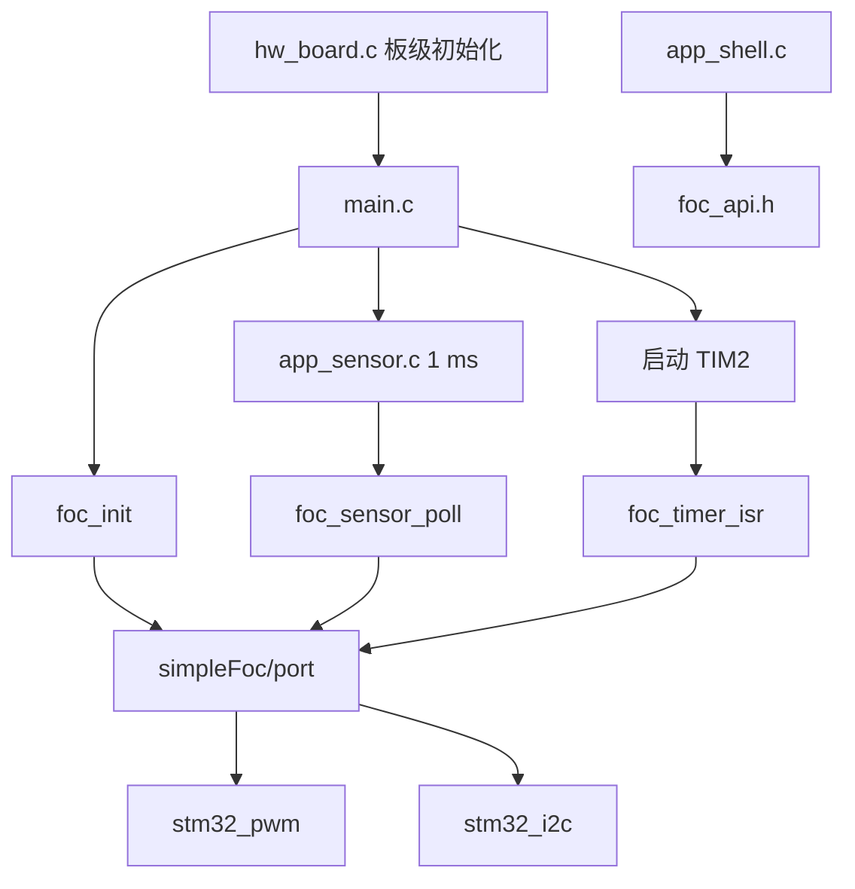

# 变更汇总

**项目**：STM32F407ZGT6 FOC  
**文件位置**：`_doc/变更汇总.md`

---

## 目录

- [1. 应用层与 SimpleFOC 移植分层（2026-11-12）](#1-应用层与-simplefoc-移植分层2026-11-12)

---

## 1. 应用层与 SimpleFOC 移植分层（2026-11-12）

**涉及文件**：`applications/main.c`、`applications/hw_board.c`、`applications/hw_time.c`、`applications/app_sensor.c`、`applications/app_shell.c`、`simpleFoc/port/foc_api.h`、`simpleFoc/port/foc_port.cpp`、`simpleFoc/port/stm32_pwm.cpp`、`simpleFoc/port/stm32_i2c.cpp`、`simpleFoc/common/time_utils.cpp`、`simpleFoc/drivers/BLDCDriver3PWM.cpp`、`simpleFoc/sensor/AS5600_I2C.cpp`

- 应用层改为纯 C：板级初始化、微秒时基、1 ms 采样线程、MSH 命令分开存放。
- 新增 `simpleFoc/port`。C++ 只通过 `foc_api.h` 向应用层提供 `foc_init`、`foc_sensor_poll`、速度读写和 `foc_timer_isr`。
- PWM、I2C 读取、`_micros` / `_delay` 从驱动和传感器类中抽到 port。
- 删除 `applications/main_Cpp.cpp`、`applications/main_Cpp.h`。`simpleFoc/common/time_utils.cpp` 保留，继续提供 `_delay()` 和 `_micros()`。
- 上电顺序不变：外设和微秒计数初始化、FOC 对象初始化、延时 1 秒、启动 TIM2、1 ms 采样。`speed` 与 `vprint` 命令保留。

⚠️ **API 签名变更**

- 删除 `main_Cpp()`、`_writeDutyCycle3PWM()`。
- `AS5600_I2C::init()` 不再接收 `I2C_HandleTypeDef*`。I2C 句柄由 `stm32_i2c.cpp` 持有。
- 应用层不再 `extern` `hi2c1`、`htim1`、`htim2` 和 `AS5600_I2C_Config`。

